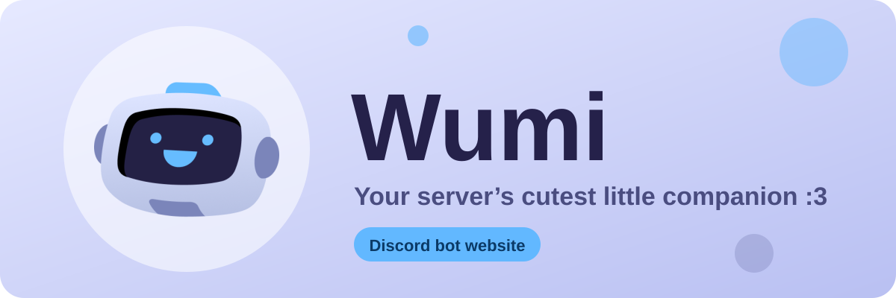

<div align="center">



<br>

[](https://discord.com/oauth2/authorize?client_id=1545770920185045084&scope=bot%20applications.commands&permissions=1426362592470)
[](https://discord.gg/VaGrXgnAHS)


[English](README.md) · **Français**

</div>

---

## À propos

Ce dépôt contient le site de **Wumi**, un petit bot Discord tout-en-un : rôles automatiques, rôles à réaction, messages de bienvenue et d’au revoir, modération et mini-jeux.

Le site est écrit en HTML, CSS et JavaScript simples. Pas d’étape de build, pas de framework, pas de dépendance. Tu ouvres un fichier et ça marche.

<div align="center">

</div>

## Fonctionnalités

- 🎀 Une page d’accueil avec un en-tête, une démo de chat, la liste des fonctions et celle des commandes
- 🌍 **Anglais par défaut**, français disponible avec le bouton EN / FR (le choix est mémorisé)
- 🌗 Mode clair et mode sombre selon le système du visiteur
- 📱 Adapté du téléphone au grand écran
- ♿ Focus visible au clavier et respect du mode « réduire les animations »
- 📄 Pages Conditions et Confidentialité séparées, prêtes à coller dans le portail développeur Discord

## Fichiers

```
.
├── index.html            # Page d’accueil
├── conditions.html       # Conditions d’utilisation (EN / FR)
├── confidentialite.html  # Politique de confidentialité (EN / FR)
├── assets/
│   ├── Logo_Bot.png      # Logo du bot
│   └── banner.svg        # Bannière de ce README
├── README.md
└── README.fr.md
```

Garde les trois fichiers HTML dans le même dossier : ils se renvoient les uns aux autres avec des chemins relatifs.

## Déployer

**Cloudflare Pages**
1. Envoie ce dossier dans un dépôt GitHub.
2. Dans Cloudflare : *Workers & Pages* → *Create* → *Pages* → *Connect to Git*.
3. Choisis le dépôt. Laisse la commande de build vide et le dossier de sortie sur `/`.

**GitHub Pages**
1. Ouvre *Settings* → *Pages* dans le dépôt.
2. Choisis la branche `main` et le dossier `/ (root)`, puis enregistre.

Une fois le site en ligne, copie les adresses dans le portail développeur Discord, dans *General Information* de ton application :

| Champ | Adresse |
|---|---|
| Terms of Service URL | `https://ton-site/conditions.html` |
| Privacy Policy URL | `https://ton-site/confidentialite.html` |

## Personnaliser

| Quoi | Où |
|---|---|
| Liens d’invitation et de support | Cherche `discord.com/oauth2` et `discord.gg` dans `index.html` |
| Couleurs | Les variables en haut du bloc `<style>` (`--bg`, `--blue`, `--ink`…) |
| Textes et traductions | L’objet `T` dans le bloc `<script>`, une entrée par texte avec une version `en` et une version `fr` |
| Liste des commandes | L’entrée `cmds` de `T` |
| E-mail de contact | L’adresse `EMAIL` dans les entrées `terms` et `privacy` de `T` |
| Logo | Remplace `assets/Logo_Bot.png`. Dans les fichiers HTML, le logo est intégré en base64 : régénère-le ou remplace-le par `` |

## Liens

- 🤖 [Ajouter Wumi à ton serveur](https://discord.com/oauth2/authorize?client_id=1545770920185045084&scope=bot%20applications.commands&permissions=1426362592470)
- 💬 [Rejoindre le serveur de support](https://discord.gg/VaGrXgnAHS)

---

<div align="center">
Fait avec 💙 pour Discord
</div>
